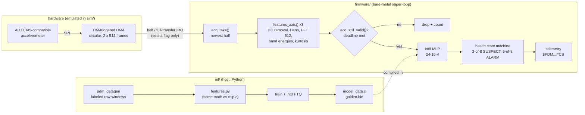
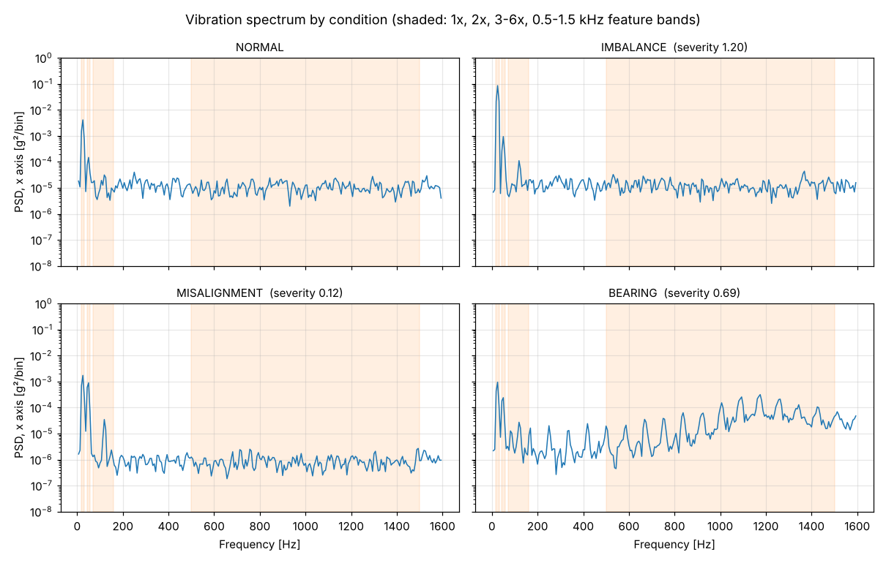
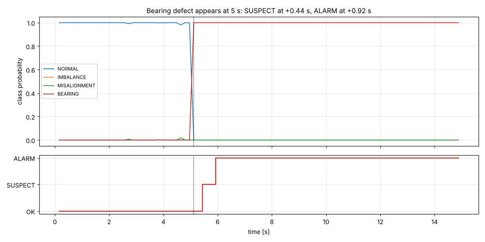
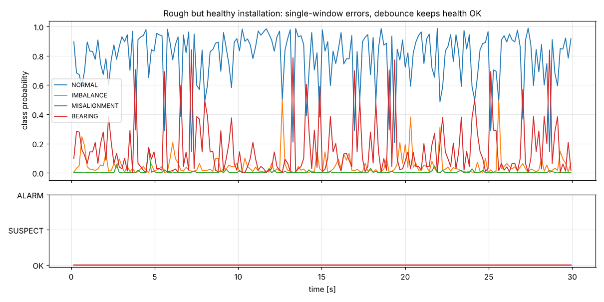
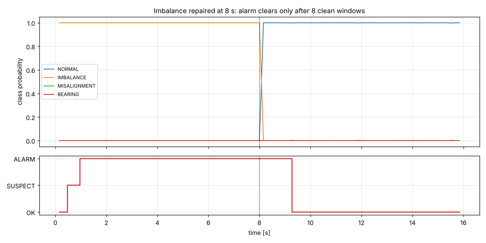
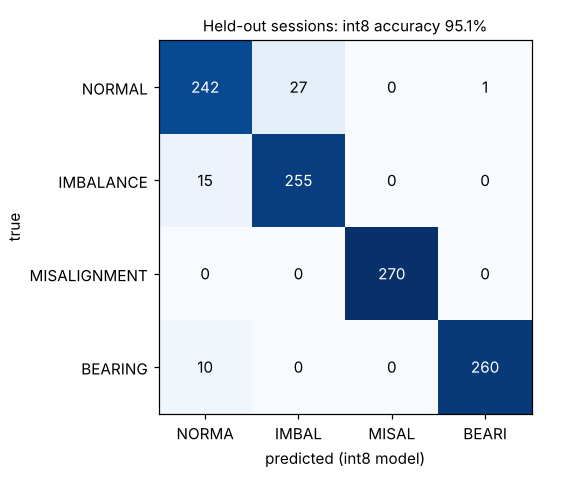

# Edge-AI Predictive Maintenance Node

Bare-metal C firmware that detects and diagnoses abnormal motor behavior **on the microcontroller**. A 3-axis accelerometer is sampled at 3.2 kHz by DMA into a ping-pong buffer. The main loop extracts frequency-domain features and runs a quantized int8 neural network. A debounced health state machine reports `OK / SUSPECT / ALARM` together with the fault type: imbalance, misalignment, or outer-race bearing defect.

> **Personal project, built and validated in simulation.**
> - **Firmware:** written for an STM32F4-class Cortex-M4F with an ADXL345-compatible accelerometer on SPI, but in this repo it runs on a PC against an emulated sensor and a motor-vibration model, through a hardware abstraction layer.
> - **Training data:** synthetic, generated from that model.
> - **Timing figures:** come from a cycle-cost model of a 168 MHz Cortex-M4F, not from measurements on silicon.

## At a glance

| | |
|---|---|
| **Pipeline** | Timer-triggered SPI DMA → ping-pong buffer → half/full-transfer ISRs (flag only) → super-loop: features → int8 MLP → health state machine → NMEA-style telemetry |
| **Real-time deadline** | 160 ms per window (512 samples at 3.2 kHz) |
| **Processing per window** | 1.37 ms average, 4.77 ms worst case (when a telemetry sentence goes out); CPU load 0.8% *(cycle model)* |
| **Model** | 24 features → 16 ReLU → 4 classes, int8 weights (TFLite-style quantization, own C kernels), **752 bytes** of flash including normalization |
| **Accuracy** (held-out installations) | int8 **95.1%**, float 94.4%; float/int8 agreement 99.2% |
| **Detection** | SUSPECT 0.44 s and ALARM 0.92 s after fault onset; clears 1.28 s after repair |
| **Memory** | 6 KB DMA buffer, 12 KB DSP working memory, all static, no heap |
| **Tests** | 46 unit-test checks (incl. golden-vector parity with Python), 20 SIL acceptance tests, CI on Linux + Windows |

## Architecture



**Design choices.**
- **DMA instead of polling or per-sample interrupts:** sampling stays regular whatever the CPU is doing.
- **Ping-pong buffer:** this is what defines the deadline. One half must be processed before DMA comes back around to it.
- **Explicit deadline check after processing:** a torn window is dropped and counted, never classified.
- **Frequency-domain features instead of raw samples:** about a few hundred bytes of model rather than a CNN on raw data.
- **Bare-metal instead of an RTOS:** there is one pipeline and one deadline.
- **Static allocation throughout.**

## Results



| Fault detection | Debounce on a rough-but-healthy machine |
|---|---|
|  |  |

| Recovery with hysteresis | int8 confusion matrix (1,080 held-out windows) |
|---|---|
|  |  |

**Model quality, honestly.**
- **Incipient faults:** severity 0.1–0.3 are recalled only 67% of the time. From severity 0.3 up, recall is 100%.
- **Single-window false positives:** 10.4% of healthy windows are flagged on their own. This is why alarms are debounced: on a deliberately rough healthy installation, 13 of 187 windows were misclassified, and health stayed `OK` for all 30 s.

**The deadline story.**
- **Fast enough normally:** processing takes about 1% of the window period.
- **Blocking debug dump at 115,200 baud:** streaming raw windows (for data collection) takes 268 ms per window, which blows the 160 ms deadline. DMA overwrites data mid-processing.
- **Silent corruption:** with the check disabled, all 45 torn windows were still classified `NORMAL` at 98% confidence. Nothing in the output reveals it.
- **With the check on:** all 45 are dropped and 29 overruns are counted.
- **At 921,600 baud:** the dump takes 34 ms and nothing is dropped.

## Build and run

Requires CMake ≥ 3.16, a C11 compiler, and Python 3 with `numpy scikit-learn matplotlib pytest`.

```bash
cmake -S . -B build && cmake --build build --config Release
ctest --test-dir build -C Release --output-on-failure    # unit tests + golden parity
pytest tests/sil -v                                      # SIL acceptance tests

./build/pdm_sim --list                                   # scenarios
./build/pdm_sim bearing out                              # one run -> out/bearing_*.csv/json/log

# regenerate training data and the model (deterministic)
./build/pdm_datagen data/train.bin 60 15 1000
python ml/train.py                                       # -> model_data.c, golden.bin, metrics.json
python tools/plots.py                                    # -> docs/img/*.png
```

### Scenarios

| Scenario | What it checks |
|---|---|
| `normal` | 20 s healthy: every window processed, no alarm, no overrun |
| `normal_marginal` | Rough healthy installation: single-window errors debounced |
| `imbalance`, `misalignment`, `bearing` | Fault at 5 s: detected and correctly diagnosed |
| `intermittent` | 0.3 s fault bursts every 4 s: no alarm |
| `recovery` | Fault repaired at 8 s: alarm clears with hysteresis |
| `debug_dump_unprotected` | Blocking raw dump, deadline check off: torn windows classified silently |
| `debug_dump` | Same with the check on: torn windows dropped and counted |
| `debug_dump_fast` | Dump at 921,600 baud fits the deadline |
| `sensor_fault` | DEVID reads 0x00: fault at boot, no acquisition, `SENSOR_FAULT` telemetry |

## Repository layout

```
firmware/  hal.h           only interface to hardware (SPI, DMA, UART, cycles, WFI, watchdog)
           accel.c         ADXL345-compatible register driver, identity check at init
           acq.c           ping-pong acquisition, overrun + torn-window detection
           dsp.c           Hann window, radix-2 FFT, per-axis features
           nn.c            int8 dense kernels, gemmlowp fixed-point requantization
           health.c        k-of-n debounce state machine with hysteresis
           telemetry.c     $PDM sentences with XOR checksum
           perf.c          per-stage cycle accounting, CPU load
           app.c           init + super-loop
           model_data.c    GENERATED by ml/train.py
sim/       motor_model.c   vibration model (imbalance, misalignment, bearing, noise, installation spread)
           adxl_emu.c      register-level sensor emulation on SPI
           sim_hal.c       virtual clock, DMA engine, ISRs, blocking UART
           sim_main.c      scenarios;  datagen.c  training-data generator
ml/        features.py     host features (must equal dsp.c)
           quant.py        int8 PTQ + bit-exact integer reference
           train.py        session-split training, quantization, export
tests/     unit/           C unit tests incl. golden parity;  sil/  pytest scenarios;  golden/golden.bin
```

## Limitations and next steps

- **Simulation only:**
  - the vibration model is simplified
  - real sensors add mounting resonances, temperature drift and EMI
  - timing figures are estimates
  
  Next step: an STM32 Nucleo-F446RE plus an ADXL345, the same scenarios replayed as HIL, and DWT-measured timings.
- **Fixed speed bands:** the bands assume roughly 1500 rpm. A variable-speed drive needs order tracking (a tachometer input or speed estimation).
- **No persistence or update path:** no event log in flash, bootloader or field update for the model.
- **Blocking UART:** telemetry blocks for about 4 ms. A DMA-driven UART would remove it from the critical path.
